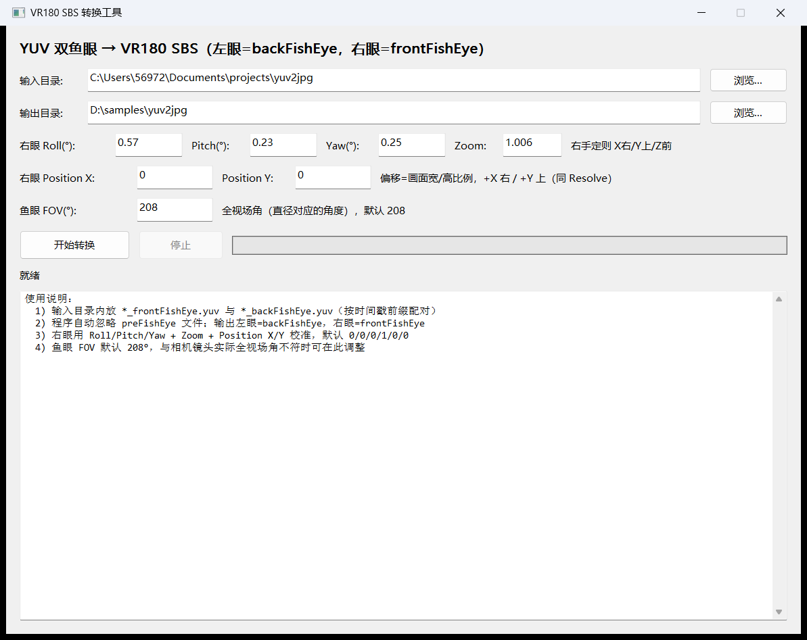

# VR180 SBS 转换工具（C++ / Win32）

把 DJI 相机落盘的 `*_frontFishEye.yuv` / `*_backFishEye.yuv`（YUV420）转换成
VR180 左右拼接的 SBS JPEG。带一个简单的 Win32 界面，也可以用命令行批量调用。




## 相比 yuv_vr180.py 的调整

1. **不处理 preFishEye 文件**：扫描时会明确忽略文件名含 `preFishEye` 的文件，
   避免它们参与时间戳配对。
2. **输出左右眼互换**：左眼 = `backFishEye`，右眼 = `frontFishEye`
   （Python 版默认是左眼 = front）。
3. **右眼 3D 校准**：用 `Roll / Pitch / Yaw` 三个姿态角、`Zoom` 缩放以及
   `Position X / Y` 平移校正右眼（`frontFishEye`），替换原来对
   `backFishEye` 的 2D 旋转。
4. 不再生成/读取 `.npz` LUT，映射表按输出行即时计算，省掉几百 MB 的缓存文件；
   同时用多线程重映射。
5. 新增 GUI 和独立的 CLI 版本，均为静态链接，复制到其它机器可直接运行。
6. **没有“打开输出目录”按钮**（按需求移除）。

## 快速开始（GUI）

双击 `VR180SBS.exe`（根目录，或 `cpp\dist\VR180SBS.exe`）。

1. **输入目录**：放 `*_frontFishEye.yuv` 和 `*_backFishEye.yuv` 的目录。
2. **输出目录**：默认等于输入目录，可另选；输出文件名为
   `<时间戳>_VR180_SBS.jpg`。
3. **右眼校准**：
   - `Roll(°)`：绕 Z 轴（光轴）旋转，正角度使最终画面顺时针转；
   - `Pitch(°)`：绕 X 轴（左右轴）旋转，正角度使最终画面向上移；
   - `Yaw(°)`：绕 Y 轴（上下轴）旋转，正角度使最终画面向右移；
   - `Zoom`：缩放右眼画面，`1` = 不变，`>1` 放大，`<1` 缩小（允许 0.1–10）；
   - `Position X / Y`：右眼画面在屏幕空间的平移，单位是**画面宽/高的比例**，
     方向与 DaVinci Resolve 的 Transform 一致：`+X` 向右，`+Y` 向上；
     例如 `0.01` 表示移动 1% 画面宽/高，`1` 表示整整一个画面宽/高（允许 ±10）；
   - `鱼眼 FOV(°)`：输入鱼眼镜头的**全视场角**（画面直径对应的角度），
     默认 **208**，允许 60–360；它只影响鱼眼→VR180 的映射比例，不改变输出尺寸；
   - 角度默认 `0`、Zoom 默认 `1`、Position 默认 `0`；
     角度可填负数，范围限制在 ±45°。
4. 点 **开始转换**，进度条和日志会显示每一对的处理情况。

界面设置保存在 exe 同目录的 `VR180SBS.ini`（UTF-8），下次启动自动恢复：

```ini
input=...
output=...
roll=0
pitch=0
yaw=0
zoom=1
fov=208
posx=0
posy=0
```

旧版本留下的 `scale=` 会被当作 `zoom=` 读取，下次保存时自动写成 `zoom=`；
没有 `fov=` 的旧配置按 208 处理。

如果 exe 所在目录没有 `.yuv`，程序会向上最多找两级目录作为默认输入目录。

## 命令行版本

```bat
VR180SBS_cli.exe --input "D:\photos\yuv" --output "D:\photos\out" --roll 0.8 --pitch 0.3 --yaw -0.5 --zoom 1.1 --posx 0.01 --posy 0.02
```

| 参数 | 说明 |
|---|---|
| `-i, --input <目录>` | 输入目录，默认当前目录 |
| `-o, --output <目录>` | 输出目录，默认与输入相同 |
| `--roll <角度>` | 右眼 Roll 校准角，默认 0 |
| `--pitch <角度>` | 右眼 Pitch 校准角，默认 0 |
| `--yaw <角度>` | 右眼 Yaw 校准角，默认 0 |
| `--zoom <系数>` | 右眼缩放，1=不变，>1 放大，<1 缩小，默认 1 |
| `--posx <比例>` | Position X，1=画面宽，+向右，默认 0 |
| `--posy <比例>` | Position Y，1=画面高，+向上，默认 0 |
| `--fov <角度>` | 鱼眼全视场角，默认 208 |
| `--quality <1-100>` | JPEG 质量，默认 95 |
| `--threads <数量>` | 线程数，默认自动 |
| `--i420` | 输入为 I420（默认 NV12） |
| `-h, --help` | 帮助 |

`--scale` 仍作为 `--zoom` 的隐藏别名兼容旧命令。

示例输出：

```
扫描: 2 个 .yuv（忽略 preFishEye 2 个，无法识别 0 个），配对 1 对
=== [1/1] 20261113161314 ===
  front: 20261113161314_frontFishEye.yuv  7680x7680, 1 帧
  back : 20261113161314_backFishEye.yuv  7680x7680, 1 帧
  右眼校准: Roll=0.800°, Pitch=0.300°, Yaw=-0.500°, Zoom=1.1000, PosX=0.0100, PosY=0.0200
  鱼眼→VR180 (FOV=208.0°)，单眼 7680x7680，SBS 15360x7680
  写出: ...\20261113161314_VR180_SBS.jpg
  完成: 15360x7680, 24.31 MB, 4.2 秒
```

## 输入约定

- 文件名含 `frontFishEye` 与 `backFishEye`，按开头的数字时间戳前缀配对。
- 文件名含 `preFishEye` 的文件直接忽略（不参与配对）。
- 只有一只眼的文件会被跳过，并在日志中提示。
- 每个 YUV 只读取**第一帧**；文件可以是单帧，也可以是多帧。
- 分辨率根据文件大小自动推断（YUV420 单帧 = `W*H*3/2`）。
- 默认按 **NV12** 解析；若相机输出 I420，请加 `--i420`。
- 假设 YUV 没有行/帧 padding。

## 输出

- 单眼为 `H×H` 正方形（H = 输入高度），SBS 为 `2H×H`。
- 左半幅 = backFishEye（不校准），右半幅 = frontFishEye
  （按 Roll/Pitch/Yaw/Zoom/Position 校准）。
- 先做鱼眼 → VR180 等距柱状（经度 ±90°、纬度 ±90°）重映射，
  再水平拼接，最后整体垂直翻转（与原 Python 版一致，修正上下颠倒）。
- JPEG 质量 95、4:4:4、无子采样，与 Python 版 Pillow 输出一致。
- 例如 7680×7680 输入 → 15360×7680 输出，约 24 MB。

## 算法要点

- **YUV → RGB**：ITU-R BT.601 limited range，系数与 OpenCV
  `COLOR_YUV2BGR_NV12` 对齐。
- **鱼眼映射**：对每个输出像素计算经纬度，转为单位球方向 `d`，
  `theta = acos(d.z)`，等距投影半径 `r = theta / (FOV/2) * radius`。实现上用
  `(theta / sin(theta))` 的等价形式，避免逐像素 `atan2 + sin + cos`。
- **右眼 3D 校准**：相机坐标系 `X 向右、Y 向上、Z 向前`，
  `R = Rz(roll) · Rx(pitch) · Ry(yaw)`（右手定则）。
  对输出方向 `d`，实际采样方向为 `d_cam = Rᵀ · d`，再做等距鱼眼投影。
  `Zoom` 直接乘在投影半径上：`r = theta / (FOV/2) * radius * Zoom`，
  `>1` 放大右眼画面、`<1` 缩小；左眼始终 `Zoom=1`。
- **Position X/Y**：在右眼完成鱼眼映射（并垂直翻转）之后，对整幅右眼画面做
  屏幕空间平移：`dx = PositionX * outW`、`dy = PositionY * outH`，
  输出像素 `(x,y)` 采样源图的 `(x - dx, y + dy)`（`+Y` 向上），越界填黑。
  与 DaVinci Resolve Transform 的 Position 约定一致（`+X` 右、`+Y` 上，
  `1` 表示一个画面宽/高）。
  角度、Zoom、Position 全部为默认值时完全跳过旋转/缩放/平移计算。
- **性能**：映射表按行生成、行内多线程；7680×7680 双鱼眼（15360×7680 SBS）
  在 16 线程 CPU 上约 **4–5 秒**（含 JPEG 编码），峰值内存约 0.9–1.0 GB。

## 重新编译

需要 Windows + MinGW-w64（g++ 13 及以上，需支持 C++17 和 Win32 线程）。
项目自带 `build.ps1`，会静态链接，不依赖 MinGW 运行库：

```powershell
cd cpp
powershell -ExecutionPolicy Bypass -File .\build.ps1
```

`-Toolchain` 可指向 MinGW 根目录（其下有 `bin\g++.exe`）；不传时先找 PATH，
再回退到 `..\_tools\w64devkit\w64devkit\bin`。当前开发机就在那里准备了便携版
w64devkit（GCC 16.2，实体目录是 `%LOCALAPPDATA%\Programs\w64devkit`），
因此直接运行上面的命令即可。产物在 `cpp\dist\`：

- `VR180SBS.exe`：GUI 版本
- `VR180SBS_cli.exe`：命令行版本

## 目录结构

```
cpp/
  src/
    core.h / core.cpp      # YUV 读取、右眼 3D 校准、鱼眼映射、SBS、JPEG、批量逻辑
    gui.h / gui.cpp        # Win32 界面
    main_gui.cpp           # GUI 入口
    main_cli.cpp           # CLI 入口
  third_party/
    stb_image_write.h      # 单头文件 JPEG 编码器（public domain）
  app.rc / app.manifest    # 资源清单（Common Controls v6、Per-Monitor DPI）
  build.ps1                # MinGW 构建脚本
  dist/                    # 编译好的 exe
  docs/                    # 截图与预览
```

## 验证

用仓库里的 7680×7680 样例，`Roll=2° / Pitch=1.5° / Yaw=-1°`，
与独立 Python 实现（同样的 3D 旋转 + 等距鱼眼映射）对比
（为节省内存按 1/4 缩放后比较）：

- 左半幅（back）vs Python 左半幅：平均绝对误差 ≈ **0.36**
- 右半幅（front，已校准）vs Python 右半幅：平均绝对误差 ≈ **0.37**
- 与对侧比较约 38.5（说明左右眼确实互换了）
- 未校准（0/0/0, Zoom=1, Position=0）的右半幅 vs 校准后的参考：约 23.2
  （说明姿态参数确实生效）
- Zoom=1、Position=0 时输出与加这些参数之前的版本逐字节一致
- Zoom=1.1 时与 Python 参考的右半幅平均绝对误差 ≈ **0.33**
- Position X=0.01 / Y=0.02、Zoom=1.1 时与 Python 参考的右半幅平均绝对误差 ≈ **0.32**；
  实测右眼画面向右移动 1% 宽、向上移动 2% 高，方向与 Resolve 一致
- FOV 生效性：同一样片分别用 `--fov 180` 与 `--fov 208` 输出，两张 JPG 哈希不同
  （208 的视野更宽）；GUI 里把 FOV 改为 190 后，日志与核心参数均显示 `FOV=190.0°`，
  转换成功。

剩下的小差异仅来自 JPEG 编码器（stb 与 Pillow）的量化差异。

## 已知限制

- GUI 里鱼眼 FOV 可调（默认 208，范围 60–360，保存在 ini 的 `fov=`）；
  CLI 用 `--fov`，两者等价。
- JPEG 编码阶段不可中断：点“停止”会等当前这张图编码完再退出。
- 只处理第一帧；多帧文件不会逐帧导出。
- 文件名配对依赖 `front` / `back` 关键字，非该命名的文件会被忽略并在日志中统计。
- 三个角度按固定顺序 `Rz·Rx·Ry` 组合；角度较大（>10°）时顺序会影响结果。
- Zoom 只作用于右眼，范围限制在 0.1–10；左眼始终为 1。
- Position X/Y 也只作用于右眼，范围限制在 ±10；数值是画面宽/高的比例，
  `0.01` 即 1%。平移后越界区域为黑色。

## 常见问题

### 进度条走完却提示“无法创建输出文件”，一张图都没有

这是**写权限问题，不是转换失败**：映射和 JPEG 编码都已成功，只是最后一步
`fopen(输出路径, "wb")` 被系统拒绝。最常见的原因是 **exe 带“低完整性（Low）”
标签**：从带 Low 标签的文件夹（沙箱/受保护目录）里复制、编译出来的 exe 会继承
该标签，进程以低完整性运行，只能写同样低完整性的目录，写 `D:\samples\...`
这类普通目录一律返回“拒绝访问”。

排查/修复：

```powershell
# 只改 exe（最小改动）
icacls ".\VR180SBS.exe" /setintegritylevel Medium

# 或整个程序文件夹递归改（以后新建/编译的文件也不会再继承 Low）
icacls "C:\Users\56972\Documents\projects\yuv2jpg" /setintegritylevel (OI)(CI)Medium /T
```

正常程序的完整性级别是 Medium；如果 exe 被标成 Low，进程就只能写带 Low 标签的
目录，写普通目录一律“拒绝访问”。`build.ps1` 现在会在编译后自动把两个 exe 标为
Medium，所以重新编译即可。

程序本身也做了预检：开始转换前会试写输出目录，失败时立即弹窗并给出系统错误
原因；如果检测到低完整性，还会直接提示上面的修复命令。转换失败时进度条会变红，
不会再出现“看起来已完成”的误解。`SaveJpeg` 先写同目录 `.tmp`，成功后再原子替换，
因此不会留下半截 JPG。

